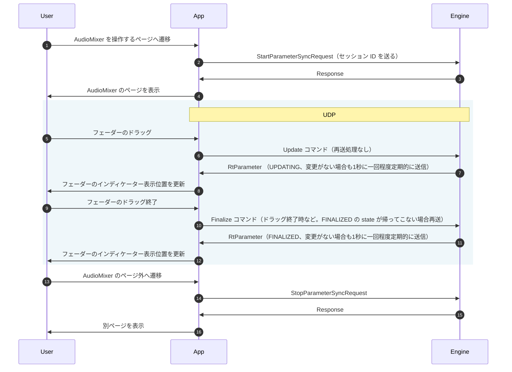

# ParameterSync のシーケンス

以下は ParameterSync の開始から終了までのシーケンス図。
AudioMixer の Volume フェーダーのドラッグフェーダーのによってパラメーターを操作するユースケースの例です。

画像: https://github.com/user-attachments/assets/e838c424-5143-4f1b-9be0-c8160d40bfde

